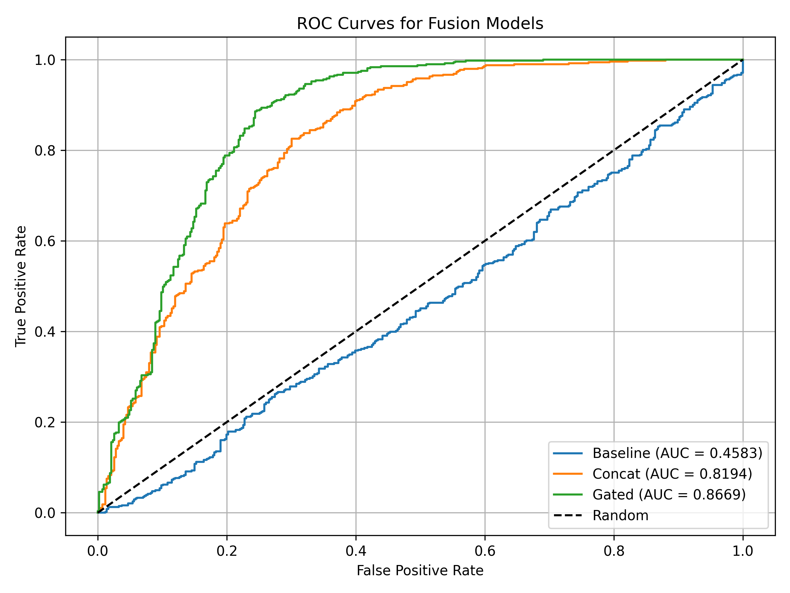

# Multimodal Image Captioning

A two-stage image captioning system for e-commerce product photos. LSTM and Transformer decoders generate candidate captions, and a discriminative model scores them and selects the best one. Fusion models then compare ways of combining image and text features.

This was a three-person team project for the graduate Deep Learning course (CSCI-P 558) at Indiana University in Spring 2026. Full details are in the [project report](report.pdf).

## My role

I built the following parts:

- **Generative models:** the LSTM and Transformer captioning models, including preprocessing, training, inference, and evaluation.
- **Discriminative model:** the image-caption matching model used to rank generated captions.

A teammate built the fusion models in [`member3_fusion/`](member3_fusion/).

## Results

These values are as recorded in the project report and were not rerun for this repository.

| Component | Accuracy | AUC | Other metrics |
|---|---:|---:|---|
| Generative models | – | – | BLEU-1 0.400, BLEU-4 0.124, ROUGE-L 0.488 |
| Discriminative model | 0.82 | 0.89 | – |
| Baseline fusion | about 0.47 | 0.458 | – |
| Concatenation fusion | about 0.75 | 0.819 | – |
| Gated fusion | about 0.81 | 0.867 | – |

The Transformer produced more detailed captions than the LSTM, but it was more sensitive to noisy data and occasionally described attributes not in the image.



## Dataset

The project uses a footwear subset of the [Amazon Berkeley Objects](https://amazon-berkeley-objects.s3.amazonaws.com/index.html) dataset: 4,529 clean samples, split into 3,623 for training and 906 for testing. Captions follow a standard pattern of gender, color, material, and type, such as `women black suede pump shoes`.

Dataset files, generated CSVs, the vocabulary, and trained model weights are not included because of their size and licensing. The scripts expect these files to exist, so you need to download the dataset, run the preprocessing, and retrain the models before running inference.

## Project structure

| Component | Files |
|---|---|
| Preprocessing | `preprocess_data.py` |
| Generative training | `train.py`, `train_transformer.py` |
| Generative inference and evaluation | `generate_captions_v1.py`, `inference.py`, `compute_all_metrics.py`, `compare_models.py`, `visualize_comparison.py` |
| Discriminative model | `discriminative_model.py`, `discriminative_dataset.py`, `train_discriminative.py`, `infer_discriminative.py` |
| Fusion models | `member3_fusion/` |

## Running the code

```bash
pip install torch torchvision numpy pandas Pillow scikit-learn matplotlib nltk

# Generative models
python generate_captions_v1.py
python compute_all_metrics.py

# Discriminative model
python infer_discriminative.py

# Fusion models
cd member3_fusion
python train_fusion.py --model baseline
python train_fusion.py --model concat
python train_fusion.py --model gated
python plot_auc_graphs.py
```
